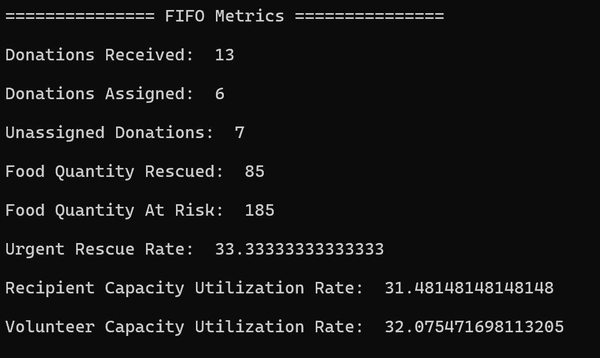
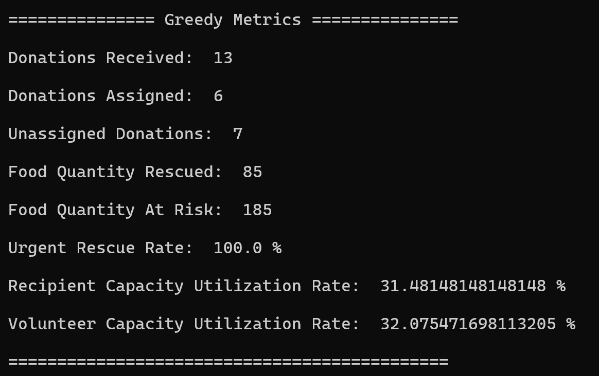

# Rescue Route

Surplus Food Matching & Pickup Planner

---

## Project Overview

RescueRoute is an explainable surplus-food matching and pickup-planning system devloped for CPSC 335.

The system matches time-sensitive food donations with compatible recipient
organizations and volunteer drivers while providing human-readable explanations
for every decision.

The project compares two scheduling strategies:

1. FIFO (First-In-First-Out) Scheduling
2. Greedy Urgency-First Scheduling

The goal is to maximize food rescue while prioritizing donations that are closest to expiration.

---

# Problem Statement

Restaurants, grocery stores, campus events, and caterers often have surplus
food that must be distributed before it expires. At the same time, community
organizations have different capacity limits, food acceptance rules, operating hours, and location constraints.

RescueRoute answers the following question:

> How can time-sensitive food donations be assigned to compatible recipients and volunteers in a way that is efficient, transparent, and easy to explain

---

# System Architecture

## Repository Structure

```text
images/
|-- fifo_metrics.png
|__ greedy_metrics.png

data/
|-- sample_input.json
|-- empty_input.json
|__ invalid_inputs.json

src/
|-- data_loader.py
|-- validation.py
|-- matching.py
|-- lookup.py
|-- scheduler.py
|-- metrics.py
|__ main.py

tests/
|-- test_matching.py
|-- test_validation.py
|__ test_sample_inputs.py
```

---

## data/

Contains all JSON datasets used by the project.

### sample_input.json

Primary dataset containing all donations, recipients, and volunteers.

### empty_input.json

Used to test empty datasets and edge cases.

### invalid_inputs.json

Contains intentionally invalid records used to verify validation logic by testing all edge cases and testing every validation rule

---

## src/

Contains all application source code.

### data_loader.py

Loads the donation, recipient, and volunteer data from JSON files.

### validations.py

Validates:

- Required fields
- Unique IDs
- Positive quantities and capacities
- Time formats
- Dataset integrity
- Accepted Food Types
- Availabilities

### matching.py

Determines whether a donation-recipient-volunteer combination is feasible.

Checks:

- Food compatibility
- Capacity constraints
- Location compatibility
- Time-Window overlap
- Volunteer pickup limits

Provides:

- Defered Message
- Rejection Reasons

### lookup.py

Creates dictionary-based lookup tables for:

- Donations
- Recipients
- Volunteers

### scheduler.py

Implements the scheduling algorithms and finds the first match

### FIFO Scheduler

Processes donations in arrival order and assigns the first feasible recipient-volunteer pair.

Creates assignment records and explanation messages.

### Greedy Scheduler

Prioritizes donations with earlier expiration times.

Creates assignment records and explanation messages.

### metrics.py

Calculates all project metrics and comparison statistics

### main.py

Provides the command-line user interface and integrates all project components. 

---

## tests/

Contains automated unit tests.

### test_matching.py

Tests the matching and feasibility logic.

### test_validation.py

Tests the validation functions and dataset integrity

### test_sample_inputs.py

Tests the required project scenarios and edge cases using the provided input files.

---

## Data Model

This system uses three primary entites:

### Donation

Attributes:

- donation_id (primary_key)
- donor_name
- food_type
- quantity
- expiry_time
- area
- ready_time

### Recipient

Attributes:

- recipient_id (primary key)
- organization_name
- accepted_food_types
- capacity
- remaining_capacity
- area
- closing_time

### Volunteer

Attributes:

- volunteer_id (primary key)
- vehicle_capacity
- area
- availability
- max_pickups

### Assignment

Attributes:

- donation_id (foreign key)
- recipient_id (foreign key)
- volunteer_id (foreign key)
- scheduled_time
- decision_reason
- status

---

# Algorithm Design

## FIFO Baseline Strategy

FIFO processes donations in the order they appear in the dataset.

Process:

1. Reads the donation.
2. Evaluate the recipients in order.
3. Evaluate the volunteers in order.
4. Select the first feasible match.
5. Record the assignment or rejection information

### Local Goal

The local goal is to assign donations while preserving arrival order, ensuring first-in-first-out.

### Limitation

FIFO may process less urgen donations before highly perishable donations because of their arrival order.
This may cause an unneccessary amount of food to expire before being assigned to a recipient-volunteer pair.

---

## Greedy Urgency-First Strategy

The Greedy strategy prioritizes donations according to their expiration time.

### Our Greedy Rule

Donations are sorted by expiration time before scheduling begins.

Donations with earlier expiration times are always considered before donations with later expiration times.

If multiple donations have the same expiration time, Python's stable
sorting preserves their original order in the dataset. 

### Process

1. Sort donations by expiration time.
2. Select the donation with the earliest expiration time.
3. Evaluate recipient-volunteer combinations.
4. Assign the first feasible match.
5. Generate assignment explanations.
6. Generate deferred explanations when appropriate.

### Local Goal

Prioritize donations that are most at risk of expiring

### Limitation

Since the Greedy strategy focuses on urgency it is not guaranteed to produce a globally optimal schedule.
Assigning by expiration times may help prevent more donations from going bad,
but may not be the most globally optimizzed based on total donations assigned.

---

# FIFO Versus Greedy: Metrics Comparison
---

The system calculates the following metrics for both scheduling strategies:

- Donations Received
- Donations Assigned
- Donations Unassigned
- Food Quantity Rescued
- Food Quantity At Risk
- Urgent Rescue Rate
- Recipient Capacity Utilization
- Volunteer Capacity Utilization

### FIFO Results



### Greedy Results



### Comparison Summary

The metrics module compares FIFO and Greedy scheduling by measuring:

- Difference in assigned donations
- Difference in rescued food quantity
- Difference in urgent rescue rate

These metrics make it possible to evaluate whether prioritizing earlier-expiring donations improves scheduling performance compared to a simple FIFO approach.

|                Metric |  FIFO  |  Greedy  |
|-----------------------|--------|----------|
| Donations Received    |     13 |       13 |
| Donations Assigned    |      6 |        6 |
| Donations Unassigned  |      7 |        7 |
| Food Quantity Rescued |     85 |       85 |
| Food Quantity At Risk |    185 |      185 |
| Urgent Rescue Rate    | 33.33% |   100.0% |

As shown above, for the provided sample dataset, the FIFO and Greedy strategies had the same metrics for everything
besides the urgent rescue rate. The Greedy strategy achieved a significantly
higher urgent rescue rate of 100.0%, compared to the FIFO baseline of 33.33%, by prioritizing donations
with earlier expiration times. 

---

# Complexity Analysis

Let:

- D = Number of Donations
- R = Number of Recipients
- V = Number of Volunteers

## Matching Procedure

Each donation may evaluate every recipient-volunteer pair in worst-case scenario.

Time Complexity:

```text
O(R * V)
```

---

## FIFO Scheduler

Each donation may evaluate every recipient-volunteer combination in worst-case scenario.
This leads to...

Time Complexity:

```text
O(D*R*V)
```

Space Complexity:

```text
O(A)
```

where A represents the number of assignment records.

---

## Greedy Scheduler

Donations are first sorted by expiration time.

Sorting Cost:

```text
O(D log D)
```

Matching Cost:

```text
O(D*R*V)
```

Overall Time Complexity:

```text
O(D log D + D*R*V)
```

Space Complexity:

```text
O(A + D)
```

---

# Testing

The project uses Python's `unittest` framework.

Covered test scenarios include:

- Normal matching cases
- Duplicate donation IDs
- Empty datasets
- Invalid datasets
- Near-expiry donations
- No compatible recipient
- Insufficient recipient capacity
- Insufficient volunteer capacity
- Competing donations
- FIFO versus Greedy scheduling behavior

---

# How To Run Program

Navigate to the source directory:

```bash
cd src
```

Run the application using:

```bash
py ./main.py
```

Menu Options:

```text
a. FIFO
b. Greedy
c. Compare Both
d. Exit
```

---


# Limitations

Current limitations include:

- Uses simulated datasets only
- Does not perform route optimization
- Greedy scheduling is locally optimal but not globally optimal
- Expiration time is the only scheduling priority


---

# Team Contributions

## Emily Tinajero

- Scheduler implementation
- Metrics implementation
- Lookup table structures
- FIFO vs. Greedy comparison metrics
- Main application integration
- Complexity Analysis
- Finalized README.md
- Testing and Debugging

## Sinjin Kim

- Data loading implementation
- Validation implementation
- Matching logic and implementation
- Decision Reasoning implementation
- Input dataset creation
- Testing and Debugging

## Ali Qazwini

- Created all automated unittests
- Demo preparation
- Designed sample-input necessary for testing
- Documentation for data files and scenarios
- Testing and Debugging

---

# References

- Python Documentation: https://docs.python.org/3/
- Python unittest Documentation: https://docs.python.org/3/library/unittest.html
- Course materials, in-class coding assignments, and project outline provided for CPSC 335

This project was developed using standard Python libraries along with course concepts
related to algorithms, data structures, testing, and greedy scheduling. 

---


